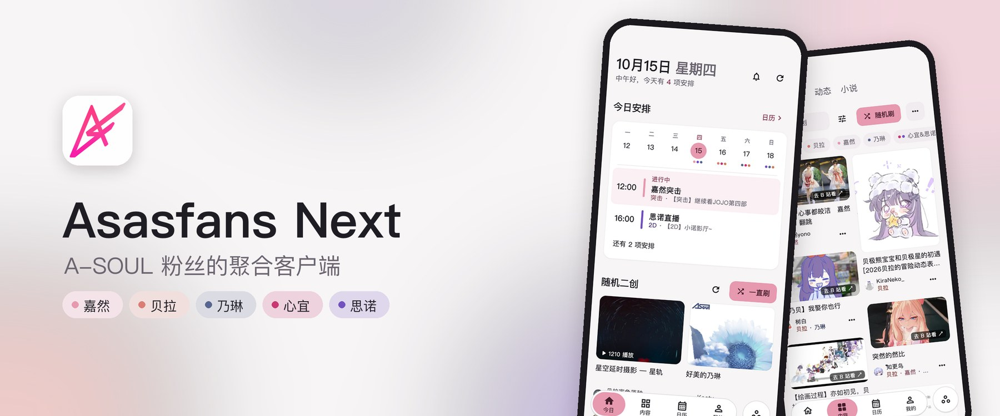
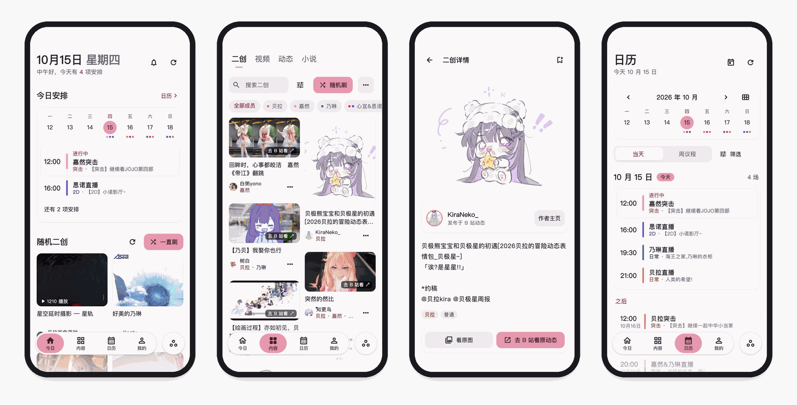
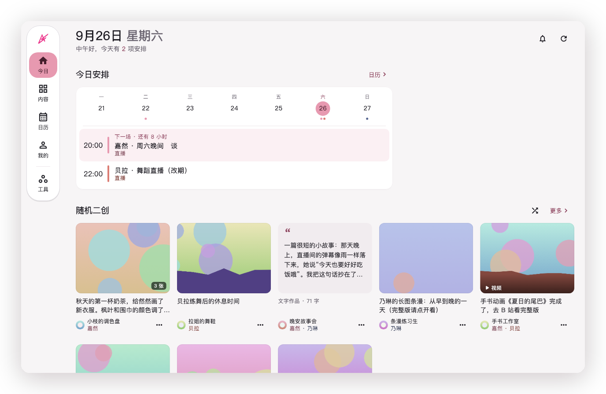
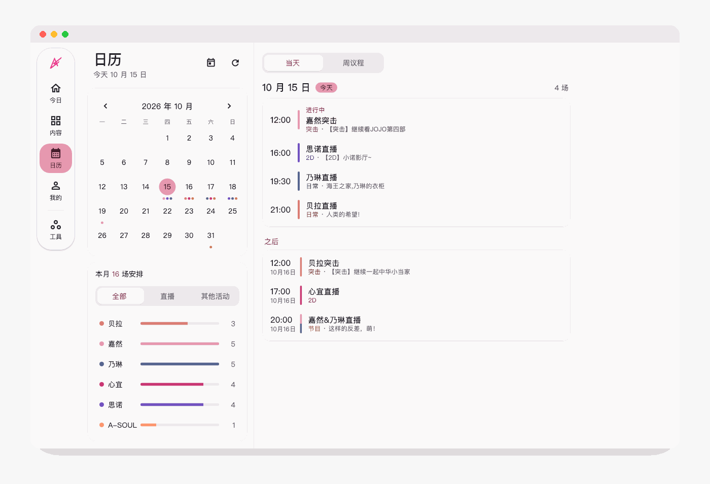

<picture>
  <source media="(prefers-color-scheme: dark)" srcset=".github/readme/banner-dark.jpg" />
  
</picture>

<p align="center">
  <a href="https://github.com/LEN5010/Asasfans-Next/releases/latest"></a>
  
  
  <a href="LICENSE"></a>
</p>

<p align="center">
  <a href="https://github.com/LEN5010/Asasfans-Next/releases/latest"><b>下载</b></a> ·
  <a href="https://github.com/LEN5010/Asasfans-Next/issues">反馈</a> ·
  <a href="https://fan.asoul.us.kg/">项目官网</a> ·
  <a href="HISTORY.md">项目历史</a>
</p>

<picture>
  <source media="(prefers-color-scheme: dark)" srcset=".github/readme/lyrics-dark.png" />
  
</picture>

<br />

<picture>
  <source media="(prefers-color-scheme: dark)" srcset=".github/readme/phones-dark.png" />
  
</picture>

<picture>
  <source media="(prefers-color-scheme: dark)" srcset=".github/readme/phones-more-dark.png" />
  
</picture>

<picture>
  <source media="(prefers-color-scheme: dark)" srcset=".github/readme/desktop-dark.png" />
  
</picture>

<picture>
  <source media="(prefers-color-scheme: dark)" srcset=".github/readme/desktop-calendar-dark.png" />
  
</picture>

<sub>截图由应用界面直接渲染，内容来自 2026 年 10 月 15 日的公开数据；作品版权归原作者所有。</sub>

## 下载

在 [Releases](https://github.com/LEN5010/Asasfans-Next/releases/latest) 页面下载对应平台的文件。

| 平台 | 文件 | 说明 |
| --- | --- | --- |
| Android 7.0+ | `-android.apk` | 签名与 2.0 相同，可以直接覆盖安装 |
| Windows 10+（x64） | `-windows-x64-setup.exe` / `-windows-x64.zip` | 推荐使用安装器；ZIP 完整解压后运行 `asasfans_next.exe` |
| macOS 12+ | `-macos.zip` | 未经 Apple 公证，首次打开请右键点应用 → 打开 |
| iOS 15+ | `-ios-unsigned.ipa` | 未签名，需要用 Sideloadly 或 AltStore 这类工具，以自己的 Apple ID 签名后安装 |

如果 macOS 提示「已损坏，无法打开」，在终端执行 `xattr -dr com.apple.quarantine "/Applications/Asasfans Next.app"` 后再打开。每个安装文件都附带一个 `.sha256` 校验文件。

Windows 安装器安装到当前用户目录，提供开始菜单入口、可选桌面快捷方式和卸载入口。之后收到更新提示，点「下载安装包」，关闭应用后运行新版安装器即可覆盖更新。收藏与设置保存在应用数据目录，安装和卸载均不删除它们。

3.0 是用 Flutter 重写的版本。原生 Android 版的最后一版是 [v2.0.0](https://github.com/LEN5010/Asasfans-Next/releases/tag/v2.0.0)，源码保存在该标签和 `old` 分支里。2.0 里的收藏和订阅不会迁移到 3.0，屏蔽规则也不会。

## 从源码构建

本项目固定使用 Flutter **3.47.3**（Dart **3.13.3**），SDK 的下载地址和校验值记录在 `tool/flutter-sdk.json`。构建时请使用仓库自带的启动脚本 `tool/flutterw`，它会先核对本机 SDK 的版本。

```sh
tool/flutterw pub get --enforce-lockfile
tool/flutterw analyze --no-pub
tool/flutterw build macos --profile --no-pub
```

Windows 上改用 `tool/flutterw.ps1`。格式化代码用 `tool/flutterw --dart format`。完整的工具链说明见 [tool/README.md](tool/README.md)。

<details>
<summary>各平台要求与 GitHub Actions</summary>

- iOS 版最低支持 iOS 15，macOS 版最低支持 macOS 12，构建这两个版本都需要 Xcode 和相应的签名配置。
- Android 版最低支持 API 24，Java 编译目标为 17，使用 Android SDK 36。
- Windows 版只能在 Windows 上构建，需要安装 Visual Studio 的 C++ 桌面开发组件。

Android 开发包的包名是 `asasfans.next.flutterdev`，可以和正式版同时安装在一台手机上。正式包沿用包名 `asasfans.next` 和原来的签名。签名文件和密码只保存在本地或 CI 密钥中，不要提交到仓库。

所有 workflow 都只能手动触发，推送和 PR 不会触发它们。

- `Flutter Checks` 用固定版本的 SDK 做格式检查和静态分析，勾选 `run_tests` 时再运行全量测试。
- `Flutter Development Validation` 可选择单个平台，Android 和 iOS 为 Debug 版，macOS 和 Windows 为 Profile 版；Windows 提供开发安装器。这些包都不签名，也不发布。
- `Flutter Release` 为一个已有的版本标签构建四个平台的安装包，Android 版使用正式签名，iOS 版不签名。安装包放进一个草稿 Release，由人确认后再手动发布。
- `Flutter Performance Validation` 按需构建一个独立包名的 Android 性能测量包，并生成体积报告。

</details>

## 致谢

本项目源自 2022 年的开源项目 [A-SoulFan/as-as-fans](https://github.com/A-SoulFan/as-as-fans)，由当前仓库继续维护和重构，并继续遵循 GPL-2.0 协议发布。

感谢 [jiarandiana0307](https://github.com/jiarandiana0307) 在 2025 年对其 [Fork 版本](https://github.com/jiarandiana0307/as-as-fans) 的维护和更新，本仓库的重构工作就是从这个 Fork 起步的。他还维护着项目官网 [fan.asoul.us.kg](https://fan.asoul.us.kg/)，以及 [枝网查重](https://cnki.asoul.us.kg/)、[枝江文库](https://book.asoul.us.kg/)、[A-SOUL Wiki](https://wiki.asoul.us.kg/) 等站点。

感谢 [枝江站](https://asoul.love/)、[ASOUL 录音棚](https://studio.asoul.us.kg/) 等 A-SOUL 社区项目。

## 反馈

问题反馈和功能建议请提交到 [GitHub Issues](https://github.com/LEN5010/Asasfans-Next/issues)。

## 声明与许可证

Asasfans Next 是非官方粉丝项目，与 Bilibili、A-SOUL 及枝江娱乐等相关公司没有官方关联。内容版权归原作者所有。

本项目基于 GNU General Public License v2.0 发布，详见 [LICENSE](./LICENSE)。
